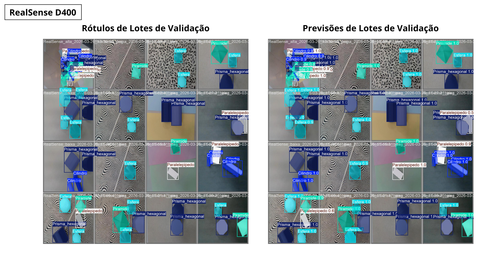
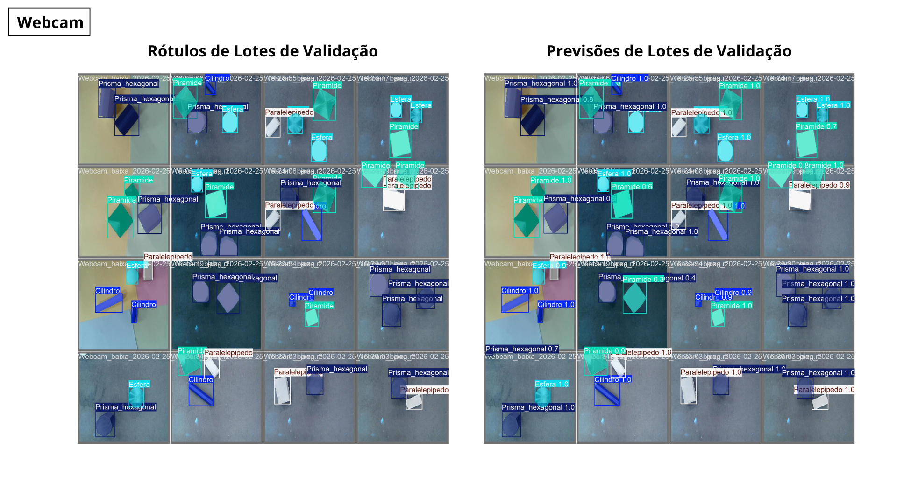

# IC-CCM-ITA

## Desenvolvimento de Aplicações de Visão Computacional com Câmera de Profundidade 

Cada vez mais rotinas de visão computacional e suas aplicações são utilizados em projetos de pesquisa, seja para aplicações de robótica industrial, quanto acadêmicas. Permitir que uma máquina diferencie e localize objetos pode contribuir para diversas atividades modernas, em muitas áreas do conhecimento. Em especial, as câmeras de profundidade da linha RealSense são citadas em muitas publicações científicas, conforme mostra Keselman, (2019).
Desse modo, o objetivo destas aplicações foram a comparação entre uma câmera de profundidade (RealSense D400) com uma Webcam pcyes 1080p raza fhd-01 1080p com a finalidade de proporcionar um estudo que analise a observação de técnicas e desempenho das aplicações de visão computacional não apenas pelo uso de softwares específicos, mas também inferindo que o hardware utilizado, distâncias focais, lentes e demais fatores físicos também podem contribuir para os resultados esperados. 

Foram realizados 6 datasets, variando condições de altura e luminosidade específicas, para que através das métricas retiradas pelos códigos de análise fosse possível chegar a conclusões de quais câmeras seriam as mais adequadas para as aplicações propostas, utilizando a segmentação de instâncias, uma técnica sofisticada em visão computacional (CV) que envolve a partição de uma imagem digital em múltiplos subgrupos de pixels, frequentemente chamados de segmentos ou regiões de imagem. Para alcançar essa compreensão de alta fidelidade, modelos de segmentação normalmente utilizam arquiteturas de aprendizado profundo (DL), especialmente Redes Neurais Convolucionais (CNNs). Essas redes atuam como poderosos extratores de características, identificando padrões como bordas, texturas e formas complexas. 

Nas aplicações realizadas, a principal análise baseou-se na fidelidade das segmentações inferidas pelos modelos quando comparadas com as originais no qual eles foram treinados. Foi utilizada a programação em Python e as plataformas VS Code e Roboflow para o trabalho com os datasets e códigos, além da própria segmentação das imagens. Como pode-se visualizar nas imagens a seguir, nas quais variaram condições de altura no dataset: 

Espera-se que com os resultados obtidos possa ter-se alcançado boas conclusões, que contribuam para o desenvolvimento e maior conhecimento acadêmico das aplicações de visão computacional. 

Muito obrigada. 

